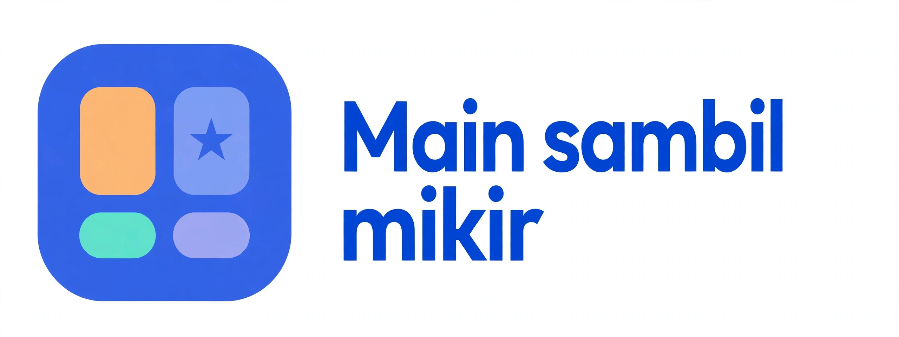

<p align="center">
  
</p>

# Final Project — Milestone 1: GameEdu
## Platform Game Edukasi Web, Smartboard, dan Mobile Terintegrasi

**Mata Kuliah:** Pemrograman Web II
**Dosen Pembimbing:** Uli Rizki, M.Kom
**Program Studi:** Informatika — Fakultas Sains dan Teknologi
**Universitas:** Universitas Nurul Huda
**Kelas:** 2024 – INF C2, Semester 5
**Repository:** https://github.com/khoirulanamid/GameEdu (Public)

---

## Nama Kelompok

**Kelompok GameEdu**

| No | Nama | NIM | Peran |
|----|------|-----|-------|
| 1 | Khoirul Anam | 2455202037 | Anggota |
| 2 | [Isi nama] | [Isi NIM] | Anggota |
| 3 | [Isi nama] | [Isi NIM] | Anggota |
| 4 | [Isi nama] | [Isi NIM] | Anggota |

> Catatan: nama dan NIM anggota 2–4 diisi oleh kelompok sebelum pengumpulan.

---

## 1. Pendahuluan

GameEdu adalah aplikasi game edukasi yang dibuat untuk membantu pendidik
atau tutor melaksanakan pembelajaran interaktif. Guru mengatur soal dan
kuis yang akan ditugaskan, siswa menjawab soal secara individu maupun
kelompok, dan interaksi di kelas ditampilkan melalui smartboard.

Milestone 1 adalah tahap fondasi proyek ini. Pada tahap ini kelompok
membentuk tim, membuat proyek baru bernama GameEdu, menyimpannya dalam
satu repository publik yang dapat digunakan untuk kolaborasi, dan membuat
tampilan web untuk guru sebagai tampilan pertama yang dinilai. Login,
database, dan permainan yang dapat dimainkan bersama adalah pekerjaan
milestone berikutnya, bukan tuntutan Milestone 1.

**Tujuan Milestone 1:**

1. Membentuk kelompok beranggotakan 4 mahasiswa.
2. Membuat proyek baru bernama GameEdu dalam satu repository publik.
3. Menyusun proyek sebagai monorepo agar frontend, backend, dan SQL
   terpisah dan mudah dirawat.
4. Membuat tampilan web untuk guru (Dashboard dan Tambah Soal).

---

## 2. Gambaran Platform

GameEdu dirancang sebagai Progressive Web Application (PWA), yaitu
aplikasi web yang dapat dibuka di browser dan dipasang seperti aplikasi
di perangkat.

| Tampilan | Pengguna | Fungsi Utama |
|----------|----------|--------------|
| Web | Guru | Mengatur soal dan kuis yang akan ditugaskan |
| Smartboard | Guru dan Siswa | Media interaktif di kelas |
| Mobile | Siswa | Menjawab soal, individu maupun kelompok |

Contoh materi pada tampilan yang diberikan dosen adalah matematika
bangun datar: pemahaman (mengenali sisi dan titik sudut) di smartboard,
dan penerapan (menemukan bentuk di sekitar kita) di mobile. Contoh
tersebut dipakai sebagai isi contoh pada template.

**Isi Dashboard Guru:**

- Bank Soal — mengelola soal dan kuis.
- Sesi Game — membuat dan mengatur sesi game untuk kelas.
- Kelas dan Siswa — mengelola kelas dan daftar siswa.
- Laporan — melihat hasil permainan dan jawaban siswa.

---

## 3. Keputusan Teknologi

| Keputusan | Pilihan | Alasan |
|-----------|---------|--------|
| Library antarmuka | React 18 + TypeScript | Satu library untuk ketiga tampilan frontend |
| Build tool frontend | Vite 5 | Cepat dan merupakan cara standar membuat proyek React baru |
| Struktur proyek | Monorepo Opsi B: `frontend/` + `backend/` + `sql/` | Frontend, backend, dan SQL masing-masing punya folder sendiri |
| Backend | Node + Express + TypeScript | Bahasa sama dengan frontend, satu `npm install` untuk semua |
| Database | PostgreSQL 16, raw SQL migration | SQL dapat dibaca langsung pada file `.sql` di folder `sql/` |
| Routing frontend | react-router-dom 6 | Berpindah halaman Dashboard, Soal, Kelas, Sesi, dan Laporan |
| Data Milestone 1 | LocalStorage + data contoh (frontend); kerangka backend dan SQL | Belum ada backend penuh; tampilan guru tetap dapat didemokan |

**Aturan pemisah yang dipegang kelompok:**

- Frontend tidak mengakses database secara langsung dan tidak mengimpor
  dari `backend/`. Frontend hanya memanggil API, misalnya
  `http://localhost:3001/api/soal`.
- Backend tidak mengimpor komponen React. Backend hanya memakai tipe
  dari `packages/types/`.
- SQL tidak ditulis di route, controller, atau service. Semua SQL berada
  di `sql/migrations/`, dan backend memanggilnya melalui `repositories/`.

---

## 4. Struktur Folder

```text
GameEdu/
├── package.json                 # workspaces: frontend/* + backend + packages/*
├── docker-compose.yml           # database Postgres lokal (pengembangan saja)
├── docs/                        # logo.png, logo-icon.png, panduan-anggota*.md, screenshot
├── .gitignore  .nvmrc (Node 20)
├── frontend/                    # SEMUA frontend (React + Vite)
│   ├── web/                     # Dashboard Guru — FOKUS Milestone 1
│   │   ├── package.json  vite.config.ts  tsconfig.json  index.html
│   │   └── src/
│   │       ├── main.tsx         # titik masuk aplikasi web
│   │       ├── App.tsx          # routing aplikasi web
│   │       ├── components/      # Layout, Sidebar, dan komponen tampilan
│   │       ├── pages/           # Dashboard, SoalList, SoalForm, dan halaman lain
│   │       ├── data/            # data contoh soal
│   │       └── lib/             # penyimpanan soal (localStorage pada Milestone 1)
│   ├── smartboard/              # kerangka Milestone 2 — media interaktif kelas
│   └── mobile/                  # kerangka Milestone 2 — PWA siswa
├── backend/                     # API SAJA (Node + Express + TypeScript)
│   ├── package.json  tsconfig.json  .env.example
│   └── src/
│       ├── index.ts             # menjalankan server (port 3001)
│       ├── app.ts               # aplikasi Express dan pendaftaran route
│       ├── routes/              # health.routes, soal.routes
│       ├── controllers/         # pengendali permintaan API
│       ├── services/            # logika dan validasi
│       ├── repositories/        # satu-satunya lapisan yang berisi SQL
│       ├── config/              # env dan koneksi database (pg Pool)
│       ├── middlewares/         # penanganan error
│       └── scripts/             # migrate dan seed
├── sql/                         # SQL SAJA (raw SQL, PostgreSQL)
│   ├── migrations/              # 001_create_soal.sql, 002_create_kelas_siswa.sql,
│   │                            # 003_create_sesi_jawaban.sql
│   ├── seeds/                   # 001_seed_soal.sql (3 soal contoh)
│   └── schema.sql               # ringkasan skema untuk dibaca
└── packages/
    ├── types/                   # tipe bersama: Soal, Kelas, Siswa, SesiGame
    │                            # dipakai frontend DAN backend
    └── ui/                      # komponen bersama: Button, Card, Badge
```

File `.gitkeep` pada folder kosong hanya penanda agar Git melacak folder
kosong tersebut. File itu dihapus saat folder sudah berisi file sungguhan.

---

## 5. Pembagian Tugas

| No | Peran | Anggota | Tugas |
|----|-------|---------|-------|
| 1 | Repository dan Integrasi | Khoirul Anam | Membuat repository publik, mengundang collaborator, menggabungkan Pull Request, menguji alur guru dan backend, merapikan repository, mengumpulkan link di Classroom |
| 2 | Frontend Web Guru — Dashboard dan Soal | [Isi nama] | Halaman Dashboard (statistik dan mulai cepat) dan Daftar Soal (tabel dan hapus); memastikan 3 soal contoh tampil |
| 3 | Frontend Web Guru — Tambah Soal dan Data | [Isi nama] | Formulir Tambah Soal (pertanyaan, 4 pilihan, jawaban benar, kategori, tingkat), validasi, penyimpanan localStorage, dan tipe Soal |
| 4 | Backend, SQL, Smartboard, dan Mobile | [Isi nama] | Backend (health dan soal, repository, migrate/seed), SQL (migrasi 001–003 dan seed), kerangka Smartboard dan Mobile, serta komponen `packages/ui/` |

Setiap anggota bekerja pada foldernya masing-masing agar tidak terjadi
konflik. Jika perlu mengubah file milik anggota lain, anggota tersebut
memberi tahu pemiliknya terlebih dahulu di grup kelompok.

---

## 6. Tahapan Pengerjaan

### Tahap 1 — Bentuk kelompok dan sepakati aturan

Membentuk kelompok 4 orang dan menyepakati nama
repository `GameEdu`, visibility Public, branch utama `main`, serta
struktur Opsi B.

**Hasil akhir:** kelompok resmi terbentuk.

### Tahap 2 — Buat repository GitHub

Salah satu anggota membuat repository `GameEdu` (Public) dan mengundang 3 anggota
lain sebagai Collaborator. Setiap anggota melakukan `git clone` dan
memeriksa aksesnya dengan `git pull`.

**Hasil akhir:** satu repository publik dan keempat anggota dapat clone.

### Tahap 3 — Pasang struktur monorepo

Menyalin struktur folder GameEdu ke repository, lalu setiap anggota
menjalankan `npm install` dan `npm run dev:web` untuk memastikan
Dashboard terbuka tanpa error. Perintah `npm run build:web` dan
`npm run build:backend` diperiksa sebelum push.

**Hasil akhir:** struktur monorepo masuk ke branch `main`.

### Tahap 4 — Kerjakan bagian masing-masing

Setiap anggota mengerjakan bagiannya sesuai Tabel Pembagian Tugas pada
Bab 5, pada branch `fitur/<nama-fitur>`, lalu membuat Pull Request yang
diperiksa satu anggota lain sebelum digabungkan ke `main`.

**Hasil akhir:** setiap halaman dan lapisan selesai pada branch-nya.

### Tahap 5 — Integrasi dan uji bersama

Menggabungkan semua branch ke `main`, lalu menguji alur guru dari awal
sampai akhir: membuka Dashboard, melihat soal contoh, menambah soal
baru, memeriksa soal tersebut muncul di Daftar Soal, memuat ulang
browser, dan menghapus satu soal. Backend diperiksa melalui
`GET /api/health` yang harus menjawab `{"status":"ok"}`.

**Hasil akhir:** alur guru dan backend kerangka berjalan tanpa error.

### Tahap 6 — Rapikan repository sebelum pengumpulan

Memastikan `node_modules/`, `dist/`, dan `backend/.env` tidak ikut
ter-commit, README sudah lengkap, dan push terakhir ke `main` sudah
merupakan hasil yang telah diuji.

**Hasil akhir:** repository bersih dan siap dinilai.

### Tahap 7 — Kumpulkan link di Classroom

Salah satu anggota menyalin link repository dan mengumpulkannya pada tugas
Milestone 1 di Google Classroom, lalu memeriksa status tugas sudah
berubah menjadi sudah diserahkan.

**Hasil akhir:** link repository publik GameEdu sudah terkumpul.

---

## 7. Aturan Kolaborasi Git

1. Selalu `git pull` di branch `main` sebelum membuat branch baru.
2. Satu branch untuk satu pekerjaan, contoh: `fitur/layout-dashboard`,
   `fitur/bank-soal`, `fitur/sesi-game`, `fitur/kelas-laporan`.
3. Commit sedikit demi sedikit dengan pesan yang menjelaskan isinya,
   contoh: `feat: tambah tabel bank soal dan filter materi`.
4. Setelah selesai, push branch dan buat Pull Request ke `main`.
   Minimal satu anggota lain memeriksa perubahan itu sebelum digabung.
5. Tidak ada yang push langsung ke `main` dan tidak ada force push.
6. Jika terjadi konflik, jangan memaksa. Tunjukkan pesan error-nya
   di grup kelompok dan selesaikan bersama.
7. Folder `node_modules/` dan `dist/` tidak boleh ikut ter-commit.

---

## 8. Cara Menjalankan Proyek

```bash
git clone https://github.com/khoirulanamid/GameEdu.git
cd GameEdu
npm install          # sekali saja, memasang semua workspace

# Frontend Guru (Milestone 1)
npm run dev:web      # http://localhost:5173

# Backend dan database (kerangka Milestone 1)
docker compose up -d db
cp backend/.env.example backend/.env
npm run db:migrate   # menjalankan sql/migrations/ secara berurutan
npm run db:seed      # mengisi 3 soal contoh
npm run dev:backend  # http://localhost:3001/api/health

# Pemeriksaan build sebelum push
npm run build:web
npm run build:backend
```

---

## 9. Checklist Milestone 1

- [ ] Kelompok 4 orang sudah terbentuk.
- [ ] Repository `GameEdu` berstatus Public dan keempat anggota menjadi collaborator.
- [ ] `npm install` dan `npm run dev:web` berjalan di laptop masing-masing anggota.
- [ ] Dashboard Guru tampil (soal, sesi, kelas, siswa, laporan).
- [ ] Tambah Soal dapat menyimpan dan muncul di Daftar Soal.
- [ ] `npm run build:web` dan `npm run build:backend` berhasil.
- [ ] `GET /api/health` menjawab `{"status":"ok"}`.
- [ ] README lengkap dan `node_modules/`, `dist/`, `backend/.env` tidak ter-push.
- [ ] Link repository sudah dikumpulkan di Google Classroom.

---

## Penutup

Milestone 1 diselesaikan pada fondasi, bukan pada fitur lengkap.
Smartboard, mobile, penyimpanan soal ke database, dan permainan yang
dapat dimainkan bersama adalah pekerjaan milestone berikutnya, dan
semuanya akan lebih mudah dikerjakan karena tempatnya sudah disiapkan
dalam monorepo ini.
